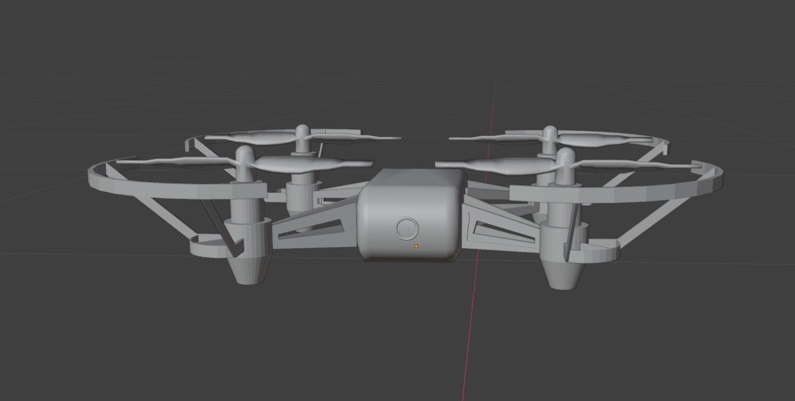
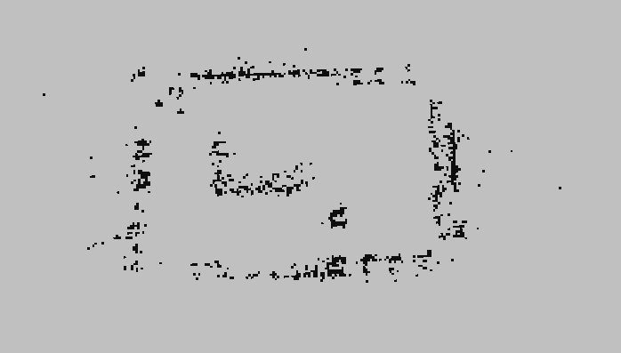
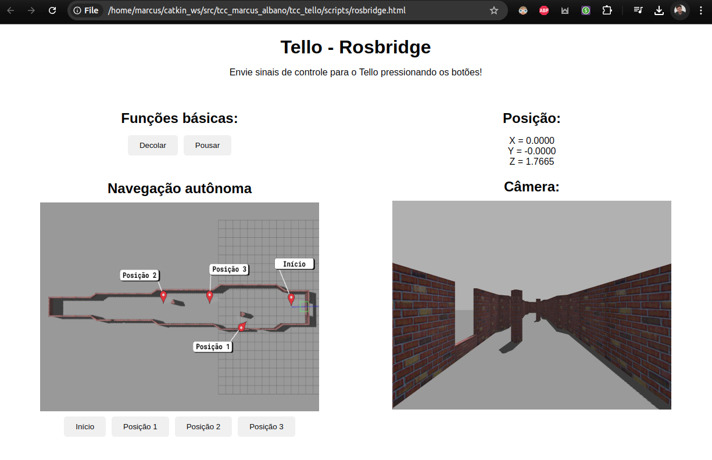

# A Proof-of-Concept Use of Unmanned Aerial Vehicle for Autonomous Person Detection and Tracking in Solar Farms

This project was developed with the goal of using the DJI Tello to perform indoor environment surveillance. To achieve this, all necessary functions were implemented by adapting and using existing packages and creating new scripts.

The Tello proved capable of performing mapping using the package ORB-SLAM3:
https://github.com/UZ-SLAMLab/ORB_SLAM3

Together with the Octomap package:
http://wiki.ros.org/octomap

This enabled the creation of a 3D map, allowing autonomous navigation through the Move_Base package:
http://wiki.ros.org/move_base

The drone's odometry was also used.

The face classifier from the OpenCV Haar Cascade library was used so that the drone could identify people in its path and start the tracking process:
https://docs.opencv.org/3.4/db/d28/tutorial_cascade_classifier.html

An automatic email sending script containing the detected face image was developed, as well as a control panel using the RosBridge package:
http://wiki.ros.org/rosbridge_suite

The project was carried out in a real environment using the Tello drone and was also developed in a simulated environment using Gazebo.

Vídeos:
<p align="center">
  <a href="https://youtu.be/q3dZaqaDLLk">
    
  </a>
  <a href="https://youtu.be/2wZg1Nzsiqk">
    
  </a>
</p>

## PREREQUISITES:

- SO: Ubuntu 20.04.5 LTS

- ROS Noetic - [Installation Guide](https://github.com/albanomarcus/tcc_marcus_albano/blob/1f0949a211ce8cd17a3977a1c874e357e6c01436/ROS_Install.md)

- Clone package:
```
cd ~/catkin_ws/src
git clone https://github.com/albanomarcus/tello_pkg.git
```
## TELLO-ROS COMMUNICATION AND TELEOPERATION
To communicate with the real drone, it is necessary to install dependent packages and clone the updated directories for Python3.

In the terminal:

```
sudo apt install ros-noetic-cv-bridge
cd ~/catkin_ws/src
git clone --recursive https://github.com/albanomarcus/tello_driver.git
git clone https://github.com/albanomarcus/camera_info_manager_py.git
cd ~/catkin_ws
catkin build && source devel/setup.bash
```

To initialize the topics responsible for communication with the Tello:

Terminal #1: 
```
roslaunch tello_pkg tello_node.launch
```

To teleoperate the Tello using the computer keyboard:

Terminal #2:
```
roslaunch tello_pkg tello_control.launch
```

## SIMULATION
The Hector Quadrotor adapted for ROS Noetic package was used as the basis for the simulation:
https://github.com/RAFALAMAO/hector_quadrotor_noetic.git

However, a new 3D model and a new URDF file were created for the Tello.

<p align="center">
  
</p>

To install the simulation environment:
```
cd ~/catkin_ws/src
git clone https://github.com/RAFALAMAO/hector_quadrotor_noetic.git
cd ~/catkin_ws
catkin build && source devel/setup.bash
```

To initialize the topics responsible for the Tello simulation:

Terminal #1:
```
roslaunch tello_pkg gazebo_tello_node.launch
```

To teleoperate the Tello in simulation using the computer keyboard:

Terminal #2:
```
roslaunch tello_pkg gazebo_tello_control.launch
```

## MAPPING
For mapping, the ORB-SLAM3 and Octomap packages were used, together with a script created to apply a scale factor to the points generated by Octomap, since the original scale did not correspond to the real-world scale.

Vídeo:
<p align="center">
  <a href="https://youtu.be/Bah-9Z6bp30">
    
  </a>
</p>


To install ORB-SLAM3, follow the [installation guide:](https://github.com/albanomarcus/tcc_marcus_albano/blob/eee8ddd550129006369752c2910a9d61d42f0281/ORB-SLAM3_instructions.md)

To install Octomap:
```
sudo apt install ros-noetic-octomap
```

After installation, initialize OrbSlam3 (either in simulation or using the Tello):
```
roslaunch tello_pkg tello_orb_slam.launch
```

After teleoperating the Tello through the environment, choose two known points in the mapped environment and their corresponding points generated by ORB-SLAM3. Modify the file scale_define.py with the chosen data and execute:
```
rosrun tello_pkg scale_define.py
```

With the scale value obtained, modify the script scale_adjustment.py and, after the point cloud generation by ORB-SLAM3 is finished, execute:
```
roslaunch point_cloud_manipulation.launch
```

The generated map contains unknown points that may affect autonomous navigation. It is recommended to apply a correction where unknown points become known and navigable points. Using the script criar_mapas.py, navigable maps were created with the same dimensions as the existing maps, and with the script mesclar_mapas.py, the new maps were merged with the previously obtained maps.

<p align="center">
  
</p>

## AUTONOMOUS NAVIGATION
Install the following dependent packages:
```
sudo apt install ros-noetic-move-base
sudo apt-get install ros-noetic-global-planner
sudo apt install ros-noetic-map-server
```

Running autonomous navigation
- Using the Tello:

  Terminal #1:
  ```
  roslaunch tello_pkg tello_node.launch
  ```

  Terminal #2:
  ```
  roslaunch tello_pkg tello_control.launch
  ```  

  Terminal #3:
  ```
  roslaunch tello_pkg tello_navigation.launch
  ```  

- Using Simulation:

  Terminal #1:
  ```
  roslaunch tello_pkg gazebo_tello_node.launch
  ```

  Terminal #2:
  ```
  roslaunch tello_pkg gazebo_tello_control.launch
  ```  

  Terminal #3:
  ```
  roslaunch tello_pkg gazebo_navigation.launch
  ```  


## FACE DETECTION AND TRACKING
The face detection and tracking process uses the Haar Cascade classifier from the OpenCV library. Upon detecting the first face, autonomous navigation is interrupted, an image of the face is captured and sent by email using the script email_sender.py, and the drone starts the face tracking procedure, following the detected person’s face until the battery runs out or an intervention command is received.

To initialize the procedure:

Terminal #4:
```
roslaunch tello_pkg tello_face_tracking_and_send_email.launch
```

O script de envio de e-mails (email_sender.py) é passível de personalização.


## CONTROL PANEL

<p align="center">
  
</p>

To create the control panel via WebSocket, the RosBridge_suite package was used.

Install:
```
sudo apt-get install ros-noetic-rosbridge-suite
```

With autonomous navigation running, open the control panel:

Terminal #5:
```
roslaunch tello_pkg tello_rosbridge.launch
```

## USAGE EXAMPLES
Using a single command, it is possible to execute all the processes described above.

- Using the Tello:
  ```
  roslaunch tello_pkg tello_node_complete.launch
  ```
- Simulation:
  ```
  roslaunch tello_pkg gazebo_tello_complete.launch
  ```

### REFERENCES

CAMPOS, C. et al. ORB-SLAM3: An accurate open-source library for visual, visual-inertial
and multi-map SLAM. IEEE Transactions on Robotics, v. 37, n. 6, p. 1874–1890, 2021.
Disponível em: <https://github.com/UZ-SLAMLab/ORB_SLAM3>.

HORNUNG, A. et al. OctoMap: An efficient probabilistic 3D mapping framework based
on octrees. Autonomous Robots, 2013. Disponível em: <https://octomap.github.io>.

Wiki ROS: <http://wiki.ros.org>


